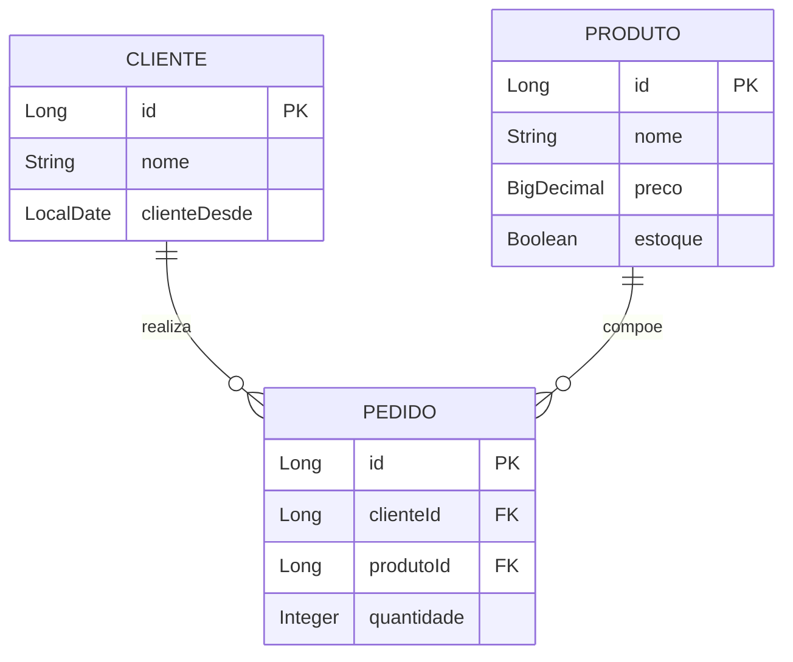

# Baozi Store — RESTful API

[](https://www.oracle.com/java/)
[](https://spring.io/projects/spring-boot)
[](https://www.mysql.com/)
[](https://opensource.org/licenses/MIT)

> API REST desenvolvida em **Java** com o framework **Spring Boot** para gerenciamento de pedidos, catálogo de produtos e controle de clientes de uma loja artesanal de pães chineses (*Baozi Store*).

---

## Sobre o Projeto

Este projeto foi concebido originalmente como uma **atividade prática acadêmica da disciplina de Desenvolvimento Web Back-End (UNINTER)**, com o propósito de aplicar e consolidar conceitos fundamentais da engenharia de software voltados para arquiteturas orientadas a serviços REST.

Além de atender às diretrizes do estudo de caso acadêmico, a API foi construída sob padrões profissionais de mercado:
- **Arquitetura em Camadas (MVC):** Separação clara de responsabilidades entre Controladores, Modelos de Domínio e Camada de Acesso a Dados.
- **Persistência Relacional com Spring Data JPA e Hibernate:** Mapeamento objeto-relacional eficiente conectado a banco de dados relacional **MySQL**.
- **Padrão RESTful:** Uso semântico de verbos HTTP (`GET`, `POST`, `PUT`, `DELETE`), payloads em formato JSON e códigos de status HTTP apropriados (`200 OK`, `201 Created`, `204 No Content`, `404 Not Found`).

---

## Arquitetura e Modelagem

O domínio do sistema é composto por 3 entidades principais:



### Estrutura de Pacotes
```text
baozi-store/src/main/java/com/baozistore/
├── BaoziStoreApplication.java    # Ponto de entrada da aplicação Spring Boot
├── controller/                   # Camada REST (Endpoints HTTP)
│   ├── ClienteController.java
│   ├── ProdutoController.java
│   └── PedidoController.java
├── model/                        # Entidades JPA (Mapeamento ORM)
│   ├── Cliente.java
│   ├── Produto.java
│   └── Pedido.java
└── repository/                   # Camada de Acesso a Dados (Spring Data JPA)
    ├── ClienteRepository.java
    ├── ProdutoRepository.java
    └── PedidoRepository.java
```

---

## Endpoints da API

### Clientes (`/clientes`)
| Método | Endpoint | Descrição | Status de Sucesso |
| :--- | :--- | :--- | :--- |
| `POST` | `/clientes` | Cadastra um novo cliente | `201 Created` |
| `GET` | `/clientes` | Retorna lista com todos os clientes | `200 OK` |
| `GET` | `/clientes/{id}` | Busca cliente por identificador único | `200 OK` |
| `PUT` | `/clientes/{id}` | Atualiza dados cadastrais do cliente | `200 OK` |
| `DELETE` | `/clientes/{id}` | Remove cliente do sistema | `204 No Content` |

### Produtos (`/produtos`)
| Método | Endpoint | Descrição | Status de Sucesso |
| :--- | :--- | :--- | :--- |
| `POST` | `/produtos` | Cadastra um produto no cardápio | `201 Created` |
| `GET` | `/produtos` | Retorna todos os produtos | `200 OK` |
| `GET` | `/produtos/{id}` | Busca produto por identificador único | `200 OK` |
| `PUT` | `/produtos/{id}` | Atualiza nome, preço ou status de estoque | `200 OK` |
| `DELETE` | `/produtos/{id}` | Remove produto do catálogo | `204 No Content` |

### Pedidos (`/pedidos`)
| Método | Endpoint | Descrição | Status de Sucesso |
| :--- | :--- | :--- | :--- |
| `POST` | `/pedidos` | Cria um novo pedido | `201 Created` |
| `GET` | `/pedidos` | Retorna todos os pedidos registrados | `200 OK` |
| `GET` | `/pedidos/{id}` | Busca pedido por identificador único | `200 OK` |
| `PUT` | `/pedidos/{id}` | Atualiza dados de um pedido existente | `200 OK` |
| `DELETE` | `/pedidos/{id}` | Cancela / remove um pedido | `204 No Content` |

---

## Tecnologias Utilizadas

- **Linguagem:** Java 17 (OpenJDK)
- **Framework:** Spring Boot 3.2.5
- **ORM / Persistência:** Spring Data JPA / Hibernate
- **Banco de Dados:** MySQL 8.x
- **Build & Dependências:** Apache Maven (com Maven Wrapper `mvnw`)
- **Testes & Documentação de Rotas:** Postman

---

## Como Executar o Projeto Localmente

### Pré-requisitos
- **Java 17** ou superior instalado
- **MySQL 8** em execução (com banco `baozistore` ou permissão para `createDatabaseIfNotExist`)

### 1. Clonar o Repositório
```bash
git clone https://github.com/YuuDaniel/baozi-store.git
cd baozi-store
```

### 2. Configurar o Banco de Dados
No arquivo `baozi-store/src/main/resources/application.properties`, ajuste as credenciais do seu MySQL:
```properties
spring.datasource.url=jdbc:mysql://localhost:3306/baozistore?createDatabaseIfNotExist=true&useSSL=false&serverTimezone=America/Sao_Paulo&allowPublicKeyRetrieval=true
spring.datasource.username=root
spring.datasource.password=SUA_SENHA
```

### 3. Executar a Aplicação
Utilizando o Maven Wrapper embutido:

**No Windows (PowerShell/CMD):**
```powershell
cd baozi-store
.\mvnw.cmd spring-boot:run
```

**No Linux/macOS:**
```bash
cd baozi-store
./mvnw spring-boot:run
```

A aplicação iniciará na porta padrão `8080` (`http://localhost:8080`).

---

## Exemplos de Payloads (JSON)

### Cadastrar Cliente (`POST /clientes`)
```json
{
  "nome": "Daniel Rodrigues Yu",
  "clienteDesde": "2026-10-11"
}
```

### Cadastrar Produto (`POST /produtos`)
```json
{
  "nome": "Baozi de Carne",
  "preco": 8.50,
  "estoque": true
}
```

### Criar Pedido (`POST /pedidos`)
```json
{
  "clienteId": 1,
  "produtoId": 1,
  "quantidade": 5
}
```

---

## Autor

Desenvolvido por **Daniel Rodrigues Yu**  
- GitHub: [@YuuDaniel](https://github.com/YuuDaniel)
- Conexão / Portfólio acadêmico e profissional em Desenvolvimento Web Back-End.

